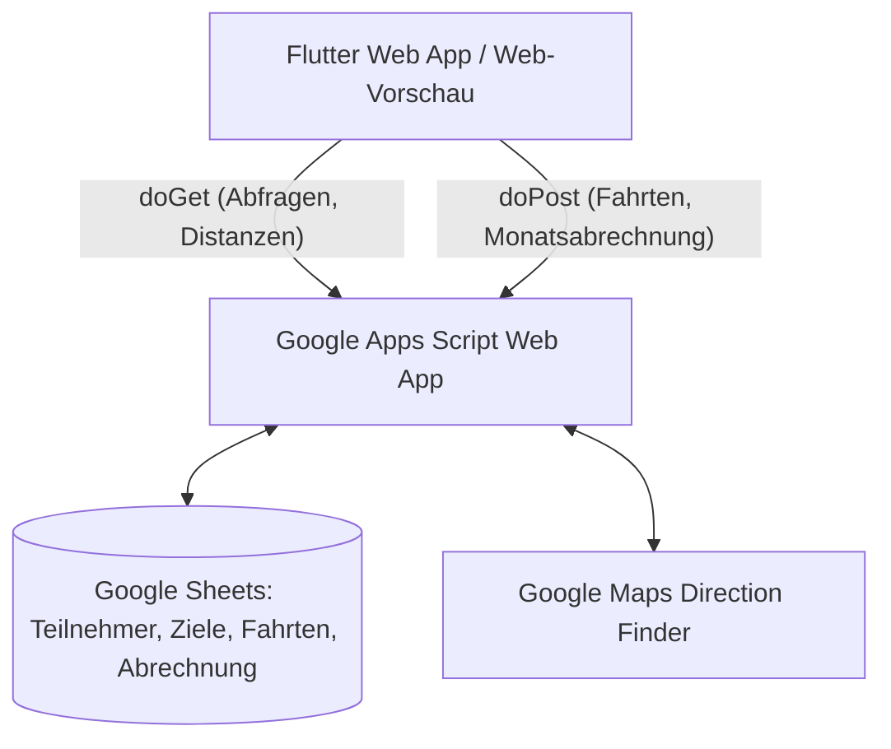

# Mitfahrgelegenheiten Management WebApp (Flutter & Google Apps Script)

Ein umfassendes System zur Verwaltung betrieblicher oder privater Fahrgemeinschaften mit nativer Google Maps Entfernungsberechnung und automatisierter Monatsabrechnung.

---

## 🏗️ Architektur & Komponenten



### 1. Frontend (Flutter Web)
- **Technologie:** Flutter (Dart) mit Material 3, Dark Mode und responsivem Desktop/Web-Design.
- **Modi:** 
  - **Demo-Modus:** Integrierte In-Memory-Testdaten (sofort start- und testbar ohne externen Server).
  - **Live-Modus:** Kommuniziert über HTTP `doGet` und `doPost` mit Ihrer Google Apps Script Web App.
- **Module:**
  - 📊 **Dashboard:** Kennzahlen, Schnellprüfer für Google Maps Entfernungen, Übersicht letzter Fahrten.
  - 👥 **Teilnehmerverwaltung:** Wohnadressen, Rollen (Fahrer, Mitfahrer, Flexibel), Kontaktdaten.
  - 🏢 **Firmenziele:** Standorte, Werkeingänge, Tor-Infos und Parkplatzhinweise.
  - 🚘 **Fahrtenbuch:** Fahrterfassung mit Google Maps Distanzabfrage, Mitfahrer-Auswahl und Kostenvorschau.
  - 💰 **Monatsabrechnung:** Monatsabschluss auf Knopfdruck, Aufteilung der Kilometerpauschale (z. B. 0,30 €/km), Fahrer-Gutschriften, Mitfahrer-Anteile und CSV-Export.
  - ⚙️ **Einstellungen:** Web-App-URL, Kilometerpauschale, Verbindungsprüfung (`ping`).

### 2. Backend (Google Apps Script `Code.gs`)
- Liegt im Ordner [`backend/Code.gs`](file:///c:/Mitfahrgelegenheit/backend/Code.gs).
- Verarbeitet:
  - `doGet`: Abruf von Teilnehmern, Firmenzielen, Fahrten, Abrechnungen sowie Live-Routendistanzen via `Maps.newDirectionFinder()`.
  - `doPost`: Anlegen, Bearbeiten, Löschen von Datensätzen und Ausführung der Monatsabrechnung.
- Verwendet Google Sheets als Datenbank (Tabellen: `Teilnehmer`, `Ziele`, `Fahrten`, `Abrechnungen`).

---

## 🚀 Sofortstart & Testen

### Option A: Sofortige interaktive Web-Vorschau (im Browser ohne Installation)
Sie können die Web-Vorschau direkt in Ihrem Standardbrowser (z. B. Chrome oder Edge) öffnen:
- Doppelklick auf die Datei: [`web_preview/index.html`](file:///c:/Mitfahrgelegenheit/web_preview/index.html)
- Die Vorschau enthält die vollständige Logik, Beispieldaten, Entfernungsrechner und Abrechnungsfunktionen.

### Option B: Flutter Web ausführen
Folgen Sie der Schritt-für-Schritt-Anleitung in [`FLUTTER_SETUP.md`](file:///c:/Mitfahrgelegenheit/FLUTTER_SETUP.md):
```bash
# 1. Abhängigkeiten laden
flutter pub get

# 2. Im Chrome-Browser starten
flutter run -d chrome
```

---

## 📁 Projektstruktur

```
c:/Mitfahrgelegenheit/
├── backend/
│   ├── Code.gs                  # Google Apps Script mit doGet, doPost und Maps API
│   └── README.md                # Anleitung zur Bereitstellung in Google Sheets
├── lib/
│   ├── main.dart                # App-Einstiegspunkt und Theme
│   ├── models/
│   │   ├── participant.dart     # Datenmodell Teilnehmer (mit Wohnadresse)
│   │   ├── destination.dart     # Datenmodell Firmenziele
│   │   ├── ride.dart            # Datenmodell Fahrten
│   │   ├── billing.dart         # Datenmodell Monatsabrechnung
│   │   └── distance_result.dart # Datenmodell Google Maps Distanzergebnis
│   ├── services/
│   │   ├── api_service.dart     # HTTP doGet & doPost Client für Google Apps Script
│   │   ├── mock_data_service.dart # Lokale Beispieldaten für Offline-Tests
│   │   └── repository.dart      # Abstraktionsschicht & Umschaltung Demo/Live
│   ├── screens/
│   │   ├── dashboard_screen.dart
│   │   ├── participants_screen.dart
│   │   ├── destinations_screen.dart
│   │   ├── rides_screen.dart
│   │   ├── billing_screen.dart
│   │   └── settings_screen.dart
│   └── widgets/
│       └── app_navigation_scaffold.dart
├── web/
│   └── index.html               # Flutter Web Template
├── web_preview/
│   └── index.html               # Interaktive Standalone Browser-Vorschau
├── pubspec.yaml                 # Flutter Paket-Konfiguration
└── FLUTTER_SETUP.md             # Flutter Installations- und Startanleitung
```
